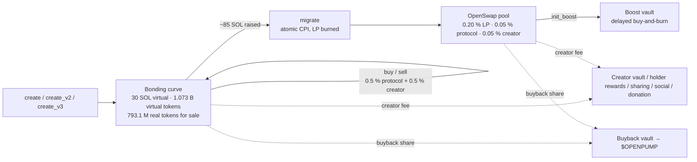

<p align="center">
  <a href="https://openpump.trade"></a>
</p>

<p align="center">
  <a href="https://openpump.trade"><b>openpump.trade</b></a> ·
  <a href="https://app.openpump.trade">Devnet playground</a> ·
  <a href="ROADMAP.md">Roadmap</a> ·
  <a href="docs/PARITY.md">Parity with pump.fun</a> ·
  <a href="SECURITY.md">Security</a> ·
  <a href="CONTRIBUTING.md">Contributing</a>
</p>

<p align="center">
  
  
  
  
  
  
  
</p>

# OpenPump

**pump.fun, open and better.** The full launchpad stack for Solana, written from scratch and published: a bonding curve, a constant-product AMM and a fee engine, built to match what pump.fun and PumpSwap do today and to go further. The community token, **$OPENPUMP**, funds the build and sits inside the protocol.

> **Status: code complete, pre-mainnet.** Three Anchor programs, a TypeScript SDK, an indexer/API and a web app. 50 integration tests pass on a local validator. Nothing is on mainnet yet; the [roadmap](ROADMAP.md) says how we get there.

---

## Contents

- [Why OpenPump](#why-openpump)
- [What's inside](#whats-inside)
- [How a coin moves through it](#how-a-coin-moves-through-it)
- [Program IDs](#program-ids)
- [$OPENPUMP](#openpump-1)
- [Roadmap at a glance](#roadmap-at-a-glance)
- [Getting started](#getting-started)
- [Repository layout](#repository-layout)
- [Design notes](#design-notes)
- [Security](#security)
- [Contributing](#contributing)

---

## Why OpenPump

pump.fun is closed source, upgradeable by one party, and keeps the entire fee stream. Every launchpad that tried to replace it so far either forked an older design or bolted a token onto someone else's contracts.

OpenPump is the whole thing, in the open:

| | |
|---|---|
| **Same mechanics people already know** | Bonding curve with virtual reserves, graduation into an AMM with burned LP, creator fees from trade #1, custom pairs, holder rewards, trade-to-earn, fee tiers by market cap, fee sharing, social and charity fees, Token-2022, multi-hop swaps, boost buy-and-burn. |
| **Owned by the people using it** | Upgrade authority goes to a multisig before mainnet, fee parameters live on-chain and are public, and the protocol's buyback share flows to $OPENPUMP. |
| **Built to be forked, audited and integrated** | Public IDLs, a typed SDK, an indexer anyone can run, a reference web app, and a [feature-by-feature parity matrix](docs/PARITY.md) that says exactly what matches pump.fun, what differs and what we left out on purpose. |

## What's inside

| Piece | Where | What it does |
|---|---|---|
| **Bonding curve** | [`programs/openpump-curve`](programs/openpump-curve) | create · buy · buy_exact_sol_in · sell · migrate · creator fees · custom pairs (any SPL or Token-2022 quote) · holder rewards · trade-to-earn volume campaigns · Token-2022 launches (`create_v3`) · admin CTO · `extend_account` |
| **AMM (OpenSwap)** | [`programs/openpump-amm`](programs/openpump-amm) | pools · deposit / withdraw · buy · buy_exact_quote_in · sell · multi-hop (coin → coin in one instruction) · AMM volume counted in the same trade-to-earn campaign · buyback share of the protocol fee · boost (delayed buy-and-burn at graduation) · kill switch · `extend_account` |
| **Fee engine** | [`programs/openpump-fees`](programs/openpump-fees) | market-cap fee tiers · creator fee sharing · social fee PDAs (fees for an X handle, claimed by its verified wallet) · donation PDAs · buyback vaults · admin CTO |
| **Shared types** | [`crates/openpump-fee-types`](crates/openpump-fee-types) | FeeConfig / SharingConfig / tier selection, read by every program |
| **SDK** | [`sdk/`](sdk) | PDAs, exact on-chain math in BigInt, instruction builders for every instruction, event decoding |
| **Server** | [`server/`](server) | SQLite indexer (decodes `emit_cpi!` events), REST + WebSocket API, metadata uploads, cranks (holder payouts, donations) |
| **Web** | [`web/`](web) | Vite + React: board, coin page (chart, trades, holders, trade panel, add / remove liquidity), create, swap, pools (list + create a pool for any SPL token), profile |
| **Site** | [`site/`](site) | The landing page at [openpump.trade](https://openpump.trade) |

## How a coin moves through it



Defaults are pump.fun's: the curve starts at 30 SOL of virtual reserves against 1.073 B virtual tokens, sells 793.1 M of the 1 B supply, and graduates after about 85 SOL. Everything is a parameter the authority can change on-chain.

## Program IDs

Fixed across clusters (localnet, devnet, mainnet).

| Program | ID |
|---|---|
| Curve | `AmSumZo1ko2pXPKCAxp2uZwcFoQrVzNkRFf4w7EEHunB` |
| AMM | `BQHw8ro8CMRQbRGDWsseCEffKksJZCqUg4K45sjA6eYb` |
| Fees | `goxedqtEDBUXsuMxYDpgfivPGZuQD4ifzfcFkhVCUe5` |

## $OPENPUMP

The community token, live on pump.fun since 2026-10-28. It launched there first because that is where the audience is; creator fees go to a public treasury that pays for mainnet deployment, audits and the rest of the roadmap.

| | |
|---|---|
| **Contract** | `72KTne4FjHhzsu2Gw3i62ncjWdGrvsTykiMniBcxpump` |
| **Trade** | [pump.fun/coin/72KTne4FjHhzsu2Gw3i62ncjWdGrvsTykiMniBcxpump](https://pump.fun/coin/72KTne4FjHhzsu2Gw3i62ncjWdGrvsTykiMniBcxpump) |
| **X** | [@openpumptrade](https://x.com/openpumptrade) |

Its hooks are already in the code:

1. **Buyback share.** The curve and the AMM route a configurable share of the protocol fee into buyback vaults; the vault authority spends it on $OPENPUMP.
2. **Quote mint.** Custom pairs let coins trade against any enabled mint. With $OPENPUMP enabled, every coin launched that way is bought and sold with $OPENPUMP.
3. **Trade-to-earn.** 30-day volume campaigns pay traders in a configured mint across curve and AMM volume, with one claim.

This is the only contract. It is also pinned on X and listed on [openpump.trade](https://openpump.trade). Anything else claiming to be $OPENPUMP is not. Treasury wallet and multisig signers get published here before mainnet.

## Roadmap at a glance

Full version with deliverables and definitions of done: **[ROADMAP.md](ROADMAP.md)**.

| Phase | Goal | Status |
|:--:|---|:--:|
| 0 | **Build** — clean-room programs at parity with pump.fun, tested | ✅ |
| 1 | **$OPENPUMP on pump.fun** — validate demand, build the community, fund the treasury | ▶ live |
| 2 | **OpenSwap on mainnet** — the AMM under a Squads multisig, verified build, swap UI, first buyback | |
| 3 | **First launch on OpenPump** — curve + fees on mainnet, first coin graduated end to end | |
| 4 | **Full launchpad** — pairs quoted in $OPENPUMP, holder rewards, trade-to-earn, tiers, sharing, social fees, boost | |
| 5 | **Harden** — external audit, bug bounty, community signers, timelocked parameters | |
| 6 | **Ecosystem** — SDK on npm, public API, bots and terminals, mobile, grants | |

## Getting started

Requirements: Rust, Solana CLI 2.x, Anchor 0.31.1, Node 20+, pnpm.

```bash
pnpm install
./scripts/build.sh            # anchor build with platform-tools v1.54 + IDLs/types for the SDK
anchor test --skip-build      # 50 integration tests on a local validator (~1 min)
cargo test --lib              # curve + AMM math unit tests
```

Run the whole stack locally with seeded data (coins at every stage, a graduated pool with a live boost, a holder-rewards coin, a custom pair):

```bash
./scripts/localnet.sh &                                   # validator with the three programs + Metaplex
cp server/.env.example server/.env                        # RPC_URL=http://127.0.0.1:8899
pnpm --filter @openpump/server start &                   # API on :8787
RPC_URL=http://127.0.0.1:8899 pnpm --filter @openpump/server exec tsx src/seed.ts
pnpm --filter @openpump/web dev                          # http://localhost:5173
```

Deploy: `anchor deploy --provider.cluster <cluster>`, then `pnpm --filter @openpump/server admin:init` (AMM config + curve Global) and `admin:fees` (fee tiers + buyback vault). After an upgrade that grew account layouts, `admin:amm-extend` resizes the AMM config and every pool in place. `pnpm --filter @openpump/server pool token|create|show` mints a test token and opens a standalone pool on the AMM (how OpenSwap is validated on devnet before the curve goes live). Server runs on Railway (`railway.json`, volume at `/data`), web on Vercel (`web/vercel.json`, `VITE_API_URL`).

## Repository layout

```
programs/
  openpump-curve/     bonding curve, custom pairs, holder rewards, incentives, Token-2022, CTO
  openpump-amm/       constant-product AMM, multi-hop, boost, buyback split
  openpump-fees/      fee tiers, sharing, social, donations, buyback vaults
crates/
  openpump-fee-types/ shared account types + tier selection
sdk/                  TypeScript SDK (PDAs, math, builders, events) + IDLs
server/               indexer, API, cranks, seed and admin scripts
web/                  the launchpad app
site/                 the landing page
tests/                Anchor integration suite
docs/                 parity matrix and design docs
evidence/             public pump.fun / PumpSwap IDLs the interfaces were shaped after
```

## Design notes

- **Clean room.** The programs were written from the public behaviour of pump.fun and PumpSwap: IDLs, on-chain events, and the community's bytecode analysis in `lalalune/pumpfun-source`. No code was copied; seeds, authorities, layouts and fee math are our own.
- **Fees leave the pool on every trade** (protocol, creator, buyback) instead of accruing inside it. There is nothing to sweep and nothing to drain.
- **One trade-to-earn campaign** covers curve and AMM volume: an AMM buy CPIs into the curve's accumulator, signed by the AMM's tracker PDA. One claim for the user.
- **Boost without moving the price.** At graduation part of the pool's quote is parked in a vault but still priced as virtual reserves; the boost authority spends it on buy-and-burns, and LP moves are locked until the vault is empty.
- **Account extension** on curve and AMM lets old accounts grow into new layouts without migrations.
- **Not cloned on purpose:** mayhem mode, cashback (pump deprecated it), fee sweeps, legacy layout migrations, reserved fee recipients, the `_v2` instruction family. Details in [docs/PARITY.md](docs/PARITY.md).

## Security

**Not audited.** The programs are tested, which is not the same thing. Before mainnet: upgrade authority in a Squads multisig with published signers, reproducible builds verified with `solana-verify`, published pause procedure, external audit. Disclosure process in [SECURITY.md](SECURITY.md).

## Contributing

Issues and pull requests are welcome; see [CONTRIBUTING.md](CONTRIBUTING.md). Good first areas: SDK examples, indexer performance, UI polish, edge-case tests.

<p align="center">
  <br/>
  <sub>OpenPump · The open-source launchpad · <a href="https://openpump.trade">openpump.trade</a></sub>
</p>
